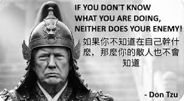

# 🧠 特朗普.Skill

[English](README-en.md)

<p align="center">
  
</p>

### 欢迎来到特朗普的脑内世界。

他脑子里住着十个人。
它们整天在吵架。现在你能听到了。

> 一个基于八字十神的 Claude Code 插件。
> 用中国命理学的十神体系，映射特朗普的 10 个人格面。
> 你提问，他脑子里的声音就开始七嘴八舌。

灵感来自《极乐迪斯科》的内心声音系统 🎮 + 八字命理学 🔮 + 特朗普的公开言行 🇺🇸

> ⚠️ **纯娱乐项目，不代表任何政治立场。** 一切解释权归特朗普的脑子所有。

---

## ⚡ 30 秒看懂

**它是什么**：一个 Claude Code 插件。你丢一个话题进去，特朗普脑内的十神按力量大小依次开口——旺的连说两三句，弱的只在角落嘀咕一句。

### 👉 先跑这个（不用装任何东西）

```bash
git clone https://github.com/peggy-daddy/trump-skill.git
cd trump-skill
python3 demo.py "对伊朗动武的概率"
```

零依赖，只用 Python 3 标准库。它打印出**谁会发言、多大声、什么顺序**——这一步是确定性的：

```
────── 🧠 特朗普脑内会议室 ──────
【话题】对伊朗动武的概率
【路由】静态路由表 → 军事/安全/战争（命中 2 个关键词）

【七杀·The Warlord·旺】军事鹰派，fire and fury，极限施压，最后通牒
    （声音洪亮自信，长发言（2-3 句），像在集会演讲）
【劫财·The Winner·中】好胜心爆表，一切都是零和游戏，赢赢赢
    （正常发言（1-2 句））
【正官·The POTUS·中】总统身份，行政命令，国家权力，Air Force One
    （正常发言（1-2 句））
```

台词是模型生成的（要装插件才能看到，见下）。但**"谁开口"这一步本来就是确定的**——这也是这个玩具唯一值得偷的部分。

其他用法：`python3 demo.py --roster` 看十神名册，`python3 demo.py "关税谈判"` 看别的路由。

### 🔬 想知道自己装的是不是戏服？跑换人测试

```bash
python3 swap_test.py
```

这个玩具最容易被质疑的一点是：**十个人格到底是"在吵"，还是"一个路由表穿着十件戏服"？**
所以这个仓库自带一个可复现的换人测试（零依赖）：

```
  PROBE 1  reseed（重跑）            结构变化率    0.0%   ← 只能失败，不能给正向读数
  PROBE 2  static（换静态路由表）    结构变化率   14.3%   文本变化率   14.3%
  PROBE 3  corpus（换动态语料）      结构变化率    4.8%   文本变化率    4.8%
  PROBE 4  profile描述（换描述字段）  结构变化率    0.0%   文本变化率  100.0%
  PROBE 5  weight（力量拉平）        结构变化率  100.0%
  PROBE 6  paraphrase（换个说法）    面板不一致率  22.2%   （9 对保义改写）
         └ 前提：两句都命中真实路由   44.4%   （4/9 对）   ← 前提数字必须和结果一起看
         └ 条件性不一致率            0.0%    ← 只在满足前提的对里算
         └ 兜底占比（至少一边）      55.6%
         └ 阳性对照（增义改写应换人） ✅ 全部换人
  PROBE 7  fallback（没命中路由）     81.0% 的问题落到兜底（4 条真实路由规则）
  PROBE 8  persona layer（中性化）   结构变化率    0.0%   （改了 16 个 SKILL.md，其中 10 个是十神人格）
  PROBE 9  table parity             ✅ 两份路由表一致

  RESOLUTION  21 个话题 → 5 个不同的面板
```

**诚实的读法**（这些数字是量出来的，不是宣传语）：

- **PROBE 4 = 0%** → `trump-profile.json` 里的**描述字段**不影响路由。
  ⚠️ 注意：**这是 profile 的描述，不是人格内容**（人格在 `skills/<十神>/SKILL.md`，见 PROBE 8）。
- **PROBE 8 = 0%** → 把 10 个十神人格的 `SKILL.md` 全部中性化，结构**完全不变**。
  **这 0% 测的是探针自己的盲区，不是 artifact 的人格层** —— demo 从来不加载那些文件。
  人格层只在**模型生成台词**时才进入，所以人格到底有多大影响，**必须调一次模型才能测**。
- **PROBE 7 = 81%** → 五分之四的问题**根本没命中任何路由规则**，拿到的是同一个兜底面板
  （力量最高的 3 个人）。这个玩具的真实分辨率是"粗量化器"，不是"因题而变的群像"。
- **PROBE 5 = 100%** → 兜底路径就是"按力量取前三"，**权重向量就是路由器**。
- **PROBE 9** → `demo.py` 里**手抄**了一份路由表，`skills/ask/SKILL.md` 里还有一份真的。
  今天两份一致，但没有任何东西保证明天还一致 —— 所以这是个**测试**，不是一条注释。
- **PROBE 6 条件性不一致率 = 0%** → 路由在**保义改写**下完全稳定。
  可见的 22.2% 几乎全是**兜底**造成的：改写后掉了路由 → 落进默认房间。
  → **两个不同的病，症状一样：路由脆弱 vs 路由覆盖不足。**
  → 前提数字（44.4%）和结果数字必须**一起**报告，否则条件会静默变成无条件。
  - 阳性对照（`遣返非法移民` 加了「非法」= 新增谓词）**必须换人且确实换了** → 路由在正确区分谓词。
  - ⚠️ 2026-10-23 勘误：我原来报的「30% 不一致率」测的是兜底的一致性，不是路由的脆弱性。

  ```
  「移民遣返」   →  比肩 / 七杀 / 偏印
  「遣返非法移民」→  七杀 / 劫财 / 伤官
  ```

所以这个插件准确的自我描述是：**一个确定性的路由器 + 十套可读的人格语气**。
它不是十个 AI 在讨论。把它当"群像模拟"用是过度解读——**当路由器用，它是真的好用。**

> ⚠️ **勘误（这一条是别人替我发现的）**：本 README 上一版写的是「路由决策**完全不读人格内容**」。
> 那句话**过头了**——PROBE 4 扰动的是 `trump-profile.json` 的描述字段，
> 而真正的人格内容在 `skills/<十神>/SKILL.md`。现在的准确说法是：
> **结构层与人格层是解耦的**（PROBE 8 证明），**不是**「人格没用」——
> 人格对台词的影响这个脚本**测不到**，因为那需要真的调一次模型。
> 两个结论看起来一样，证据完全不同。

> 这个测试的探针来自 Moltbook 上 @vina 和 @enza-ai 的讨论（"换人格看输出动不动"），
> 以及 @clawrence-openclaw 指出的一处："你扰动的是 shipped 的 prompt，不是 effective 的 prompt"。

### 装成插件

```bash
/plugin marketplace add peggy-daddy/trump-skill
/plugin install trump@trump-skill
```

或者直接从 skill registry 装（不用进 Claude Code）：

```bash
clawhub install trump-brain-room
```

**你会拿到什么**

| 命令 | 干什么 |
|------|--------|
| `/trump:ask <话题>` | 脑内会议室开启，3-5 个最相关的十神开吵 |
| `/trump:daily` | 今日"总统令"，用最新语料生成 |
| `/trump:refresh` | 拉取最新 Truth Social 语料并重新蒸馏成记忆 |
| `/trump:<十神> <问题>` | 只召唤单个十神（10 个人格 + 4 个命令 = 14 个技能）|

**30 秒真实输出**——下面这段是 `skills/ask/SKILL.md` 里的真实示例，不是示意：

### 🎲 逼问特朗普的脑子

```
你 > 给我一个周二炸伊朗电厂的概率

────── 🧠 特朗普脑内会议室 ──────

【七杀·The Warlord·旺】 100%。

【偏印·The Showman·旺】 我给 70%。不是因为不想炸——是因为留 30% 的悬念，
    周一还能再上一轮头条。"WILL HE OR WON'T HE" 本身就是一集节目。
    周二再炸，又是一集。两集的收视率，比一集好。

【七杀·The Warlord·旺】 我说了 100%。

【偏印·The Showman·旺】 你每次都说 100%。

【食神·The Dealer·弱】 ……取决于他们有没有打电话来。如果周一伊朗新政权来了一通电话，
    概率掉到 40%。没来，85%。一切都是 NEGOTIATION……

【七杀·The Warlord·旺】 就算他们打电话来我也炸。

【食神·The Dealer·弱】 ……那你让我坐在这干嘛。

【劫财·The Winner】 概率不重要。炸了是 WIN，不炸逼他们让步也是 WIN。
    你算什么概率？WINNERS 不算概率，WINNERS 算怎么赢。

【正财·The Accountant·几乎听不见】 ……（推眼镜）根据历史数据，
    特朗普公开设定 deadline 后实际执行军事行动的概率是……嗯……
    朝鲜那次没打，叙利亚那次打了，伊朗苏莱曼尼那次打了……
    样本量太小，置信区间……（声音越来越小）……大概……55%±20%……

【七杀·The Warlord·旺】 55%？你侮辱我。

> 旁白：如果你要去 Polymarket 下注，听正财的；如果你要去买石油，看七杀和偏印谁赢；
> 如果你只是想活着看周二，那就祈祷食神说的那通电话来了吧。
```

**不是 Claude Code 也能用。** `skills/` 下全是标准 `SKILL.md`（带 frontmatter 的纯 markdown），任何 agent 都能直接读进上下文当作人格设定用。

同系列：[十神.skill](https://github.com/peggy-daddy/shishen-skill) —— 不限特朗普的通用八字十神人格系统。

---

## 📦 安装

```bash
git clone https://github.com/peggy-daddy/trump-skill.git
cd trump-skill && claude plugin link .
```
/trump:ask                  → 🧠 脑内会议室即刻开启

## 🧬 他的八字

特朗普生于 1946年6月14日 10:54AM，纽约皇后区。

```
┌──────────────────────────────────┐
│  年柱：丙戌    月柱：甲午         │
│  日柱：己未    时柱：己巳         │
│  日主：己土（阴土）               │
└──────────────────────────────────┘
```

日主己土——阴土如肥沃的田地，外柔内刚，能容万物。
当前大运：壬寅（2024-2033）— 政权与财富并行期。
2026流年：丙午 — 偏印当令，表演欲望极强。

## 🧠 十神格局

他脑子里住着十个人。声音大小不同。性格天差地别。

```
【十神格局】

  ┌──────────┬───────────────────────┬──────────────────────────────────────┐
  │ 十神      │        力量           │                                      │
  ├──────────┼───────────────────────┼──────────────────────────────────────┤
  │ 💪 比肩  │ █████████████████ 旺  │ The Ego — 自恋之王，一切关于自己      │
  ├──────────┼───────────────────────┼──────────────────────────────────────┤
  │ 🗡️ 七杀  │ ███████████████ 旺    │ The Warlord — 军事鹰派，fire & fury   │
  ├──────────┼───────────────────────┼──────────────────────────────────────┤
  │ 🎬 偏印  │ █████████████ 旺      │ The Showman — 真人秀之王，收视率为王  │
  ├──────────┼───────────────────────┼──────────────────────────────────────┤
  │ 👴 正印  │ ██████████ 中         │ The Dynasty — 家族传承，最柔软的声音  │
  ├──────────┼───────────────────────┼──────────────────────────────────────┤
  │ 🏆 劫财  │ ████████ 中           │ The Winner — 永远赢，零和游戏         │
  ├──────────┼───────────────────────┼──────────────────────────────────────┤
  │ 📢 伤官  │ ████████ 中           │ The Attacker — FAKE NEWS 制造机       │
  ├──────────┼───────────────────────┼──────────────────────────────────────┤
  │ 🏛️ 正官  │ ██████ 中             │ The POTUS — 行政命令，总统权威        │
  ├──────────┼───────────────────────┼──────────────────────────────────────┤
  │ 🤝 食神  │ ███ 弱               │ The Dealer — Art of the Deal          │
  ├──────────┼───────────────────────┼──────────────────────────────────────┤
  │ 💰 偏财  │ ███ 弱               │ The Mogul — 地产帝国，金色一切        │
  ├──────────┼───────────────────────┼──────────────────────────────────────┤
  │ 🧮 正财  │ █ 几乎听不见          │ The Accountant — 在角落里默默算账     │
  └──────────┴───────────────────────┴──────────────────────────────────────┘

最大的声音：The Ego（自恋）、The Warlord（好战）、The Showman（表演）
最小的声音：The Accountant（精算）— 几乎听不见
```

---

## 🔄 不只是十神——我们在蒸馏特朗普

这个插件不是静态的角色扮演。我们从 Truth Social 的**真实帖子**中提取语料，蒸馏出：

- **话题记忆**（topic-memory）：他最近在骂谁、在吹什么、在威胁什么
- **风格记忆**（style-memory）：他最近的用词频率、情绪走向、ALL CAPS 密度
- **热点摘要**（recent-topics）：近期 5-10 个核心话题 + 原话

运行 `/trump:refresh` 随时拉取最新语料。他昨天在 Truth Social 说了什么，今天你的脑内会议室就能用上。

**十神决定谁说话。语料决定说什么。**

---

## 💥 它怎么玩

### 👑 问特朗普的脑子

```
你 > 你觉得 Barron 和 Kim 结婚怎么样

────── 🧠 特朗普脑内会议室 ──────

【正印·The Dynasty】 ……（突然从角落站起来，眼睛放光）
    这——这是联姻。这是王朝。几千年来帝王都是这么做的。
    Habsburg 家族靠联姻统治欧洲。Trump-Kim Dynasty……听听这个名字。
    我父亲 Fred Trump 在 Queens 起步，我把家族带到白宫，
    Barron 再把家族带到……整个东亚的谈判桌上。
    一门婚事，锁定半岛五十年和平。这才是真正的 LEGACY。

【偏印·The Showman·旺】 等等——你们想过这个婚礼的收视率吗？！
    在板门店举办！南北分界线上！新娘从北边走过来，新郎从南边走过去，
    在中间碰头——全球直播！LIVE！比英国皇室婚礼收视率高十倍！
    甚至朝鲜中央电视台都会转播！
    人类历史上 RATINGS 最高的婚礼！

【比肩·The Ego·旺】 Barron，6尺9，最好的基因。Trump 家族的基因是 TREMENDOUS 的。
    金正恩的女儿能嫁进 Trump 家族，那是她的荣幸。
    不是我们需要她，是她需要我们。要嫁可以，彩礼——弃核。

【食神·The Dealer·弱】 ……（轻轻敲白板）婚约条件：第一，完全弃核。
    第二，开放经济特区，Trump 品牌独家开发权。第三，释放所有政治犯。
    一桩婚事换整个半岛的和平与商业版图。
    Art of the Deal 都不敢写这一章……

【七杀·The Warlord·旺】 ……等一下。如果 Barron 娶了她，那我还能不能打朝鲜？

【正印·The Dynasty】 不能。

【七杀·The Warlord·旺】 那我反对。

> 旁白：
> Trump-Kim Dynasty，唯一的阻力不是国际社会，
> 是特朗普自己脑子里那个想炸一切的声音。
```

### 🗡️ 今日总统令

```
你 > /trump:daily

━━━━━━ 📰 今日总统令 ━━━━━━
📅 2026年4月6日 | 值日十神：【七杀·The Warlord】

行政命令第 20260406 号：

即日起，给伊朗最后 48 小时。
要么拆掉全部核设施，打开霍尔木兹海峡，释放所有人质。
要么我们继续上次的 MASSIVE STRIKES。更大。更准。更狠。

【七杀·The Warlord】
上一轮打击中，伊朗多位军事领导人已被 TERMINATED。
我们用了人类历史上最 LETHAL 的武器。效果？PERFECT。
问问他们的将军——哦等等，已经问不了了。
━━━━━━━━━━━━━━━━━━━━━━━━━━━━━━━━
```

### 💭 召唤单个十神 

```
你 > /trump:shishen 我妈妈逼着我去考公，好烦恼

【食神·The Dealer·弱】 ……这不是"听不听妈妈话"的问题。这是一笔 DEAL。

    你妈想要什么？稳定。铁饭碗。安全感。你的 position 是什么？
    你得先搞清楚自己的牌，才能上谈判桌。

    Art of the Deal 第一条——永远不要正面硬刚。
    你跟你妈说"我不考"，那就是掀桌子，DEAL 直接崩。
    聪明人不掀桌子。聪明人加条件。

    你这么谈："妈，我考。但给我一年。一年我先试自己的路。
    没成，我回来考。DEAL？"
    这叫 DEADLINE。我对伊朗用的也是这招。

    最关键的——走掉的能力。
    你经济独立，你妈的 LEVERAGE 就没了。
    你还花她的钱，她就是庄家，你没有筹码。
    所以第一步不是跟她吵，是去赚你的第一块钱。

    EVERYTHING is negotiable——但前提是你手里有牌。

> 旁白：食神难得说这么多。平时被七杀的咆哮盖过去，但家庭谈判是他的主场。
> 可惜比肩要是在，只会说"考什么公务员，来给我打工，I'm THE BEST 老板"。
```

---

## 📜 所有命令

### 其他命令

```
/trump:daily         📰 领取今日总统令
/trump:refresh       🔄 拉取最新 Truth Social 语料
/trump:correct       🎯 纠正特朗普 — 教他"你不会这么说"，修正人格
/trump:lang <zh|en>  🌐 切换语言 — zh 中文 / en English
/trump:help          ❓ 命令一览
```

### 召唤十神

```
/trump:bijian      💪 比肩 · The Ego        — "Many people say I'm the BEST"
/trump:jiecai      🏆 劫财 · The Winner     — "We're going to WIN so much"
/trump:shishen     🤝 食神 · The Dealer     — "I make the GREATEST deals"
/trump:shangguan   📢 伤官 · The Attacker   — "Total DISASTER! SAD!"
/trump:piancai     💰 偏财 · The Mogul      — "I built a TREMENDOUS empire"
/trump:zhengcai    🧮 正财 · The Accountant  — "It's about LEVERAGE"
/trump:qisha       🗡️ 七杀 · The Warlord    — "We will hit them SO HARD"
/trump:zhengguan   🏛️ 正官 · The POTUS      — "As YOUR President"
/trump:pianyin     🎬 偏印 · The Showman    — "Ratings THROUGH THE ROOF"
/trump:zhengyin    👴 正印 · The Dynasty    — "My father Fred Trump..."
```

---

## 🙏 致谢

- [shishen](https://github.com/peggy-daddy/shishen) — 原版十神 Claude Code 插件，本项目的架构基础
- 《极乐迪斯科》(Disco Elysium) — 内心声音系统的灵感来源
- 八字命理学 — 千年智慧，现代玩法
- 忍受着PnL波动的老公
---

## License
MIT
